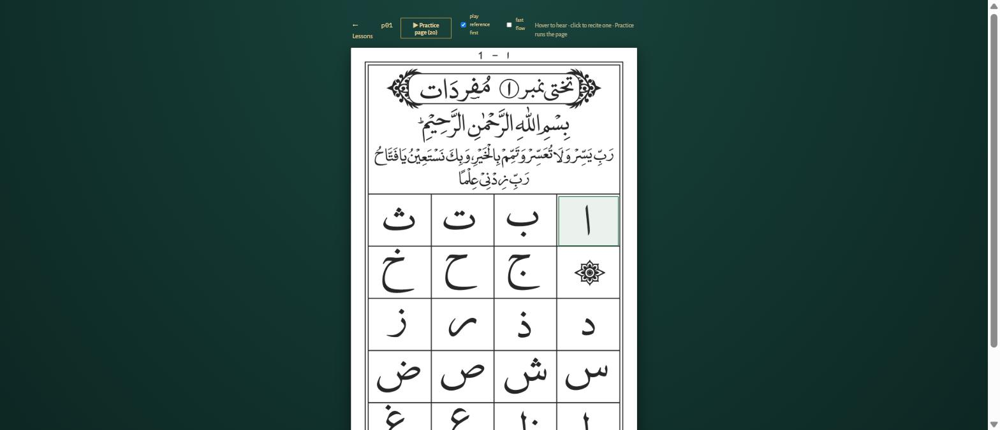
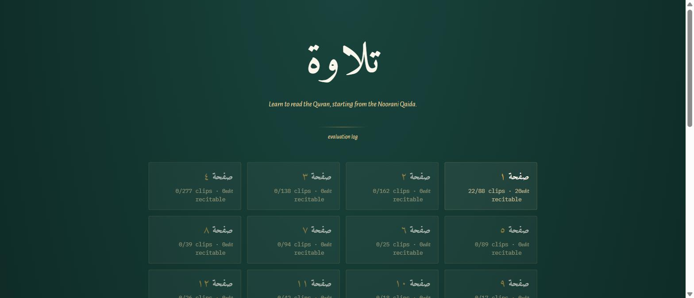
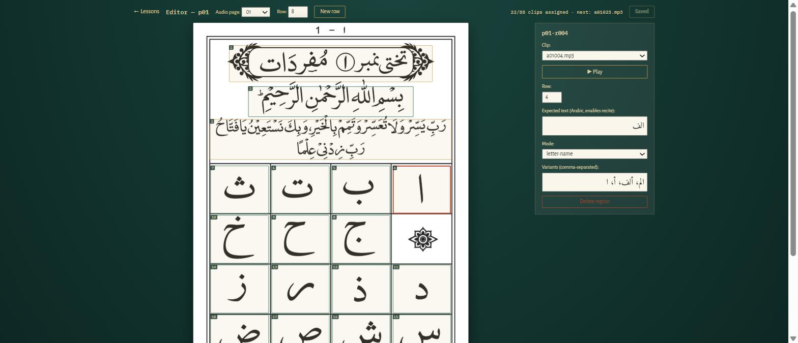
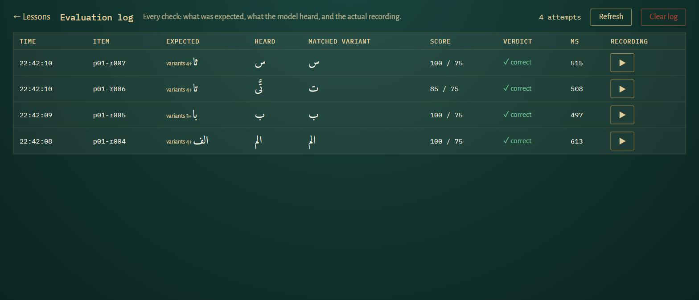

# Tilawah — تلاوة

AI-powered Quran reading tutor (Final Year Project). A beginner works through the
Noorani Qaida page by page: **hover** a word to hear it, **click** it and recite into
the microphone — a Quran-tuned Whisper model transcribes the recitation, compares it
to the expected Arabic, and replays the reference audio on mistakes.

> **Private repo — FYP team only.** The Qaida page scans and audio clips in
> `content/` are extracted from the Android app *Noorani Qaida with Audio*
> (`com.creativeapps.nooraniqaidawithaudio`) and are included here **solely for
> private academic use**, with credit to the original publisher. Do not make this
> repo public, deploy it, or publish the assets anywhere.

```
tilawah-ai/
├── frontend/     React 19 + TypeScript + Vite — learner UI and hotspot editor
├── backend/      FastAPI — content API, Whisper ASR, Arabic matching and verdicts
├── content/      39 page scans, 1398 word-level MP3 clips, hotspot region JSON
├── cloud/        Optional GPU transcription server + Colab notebook
└── docs/         FYP feasibility guide (PDF), FYP-1 defence slides (PPTX), screenshots
```



---

## Requirements

- **Python 3.12** — `faster-whisper` has no wheels for 3.13+, it will try to build
  `ctranslate2` from source and fail
- **Node.js 20+**
- **Chrome or Edge** — the recorder needs `audio/webm;codecs=opus`, Safari won't work
- A working microphone

## Install

```powershell
git clone https://github.com/abdul-ahad-26/tilawah-ai-fyp.git
cd tilawah-ai-fyp

# backend
cd backend
py -3.12 -m venv .venv
.\.venv\Scripts\Activate.ps1
pip install -r requirements.txt

# frontend
cd ..\frontend
npm install
```

The clone is ~130 MB — the page images, audio clips and the converted `tiny` model
are all in the repo, so there is nothing else to download or import.

If PowerShell blocks the activate script:
`Set-ExecutionPolicy -Scope CurrentUser -ExecutionPolicy RemoteSigned`

## Run

Two terminals:

```powershell
# 1 — backend
cd backend
.\.venv\Scripts\Activate.ps1
uvicorn app.main:app --reload --port 8000

# 2 — frontend
cd frontend
npm run dev
```

Open <http://localhost:5173>. Vite proxies `/api` to port 8000, so there is nothing
to configure.

**The first backend start downloads the ASR model** (`OdyAsh/faster-whisper-base-ar-quran`,
~150 MB) into the Hugging Face cache. One-time cost. Wait for `ASR warm-up complete`
in the log before reciting — `curl http://127.0.0.1:8000/api/health` should report
`"modelLoaded": true`.

## Using it

| Route | What it does |
| --- | --- |
| `/` | Lesson grid — all 39 pages and how much of each is mapped |
| `/lesson/:pageId` | Learner view — hover to hear, click to recite, or practice the page |
| `/editor/:pageId` | Hotspot editor — draw regions, assign clips, add expected text |
| `/logs` | Every recitation attempt with its audio, transcription and score |
| `/collect` | Record every recitable item of pages 1–12 for the evaluation dataset (consent, anonymous speaker id, re-record, skip, export) |

The home page also shows the current learner's progress (name field, weak letters,
"Revise these"), kept in `data/progress/<name>.json`; see **Progress** below.

`pageId` is `p01` … `p39`. **All 39 pages are mapped** (takhti 1–27, 1397 of the 1398
clips; the last is a byte-identical duplicate). Page 1 was drawn by hand in the
editor; pages 2–39 were generated by `backend/scripts/map_qaida.py`, which finds the
ruled grid on each scan (`qaida_grid.py`) and assigns clips in reading order from the
layout written down in `qaida_spec.py`. One takhti's audio can span several scans,
and one scan can finish a takhti and start the next, so a page's `audioPage` is the
takhti it starts in, not its scan number. To change a generated page, edit
`qaida_spec.py` and re-run `python scripts/map_qaida.py --write` from `backend/`, or
hand-edit it in `/editor`. Pages 1–12 (the FYP scope) are letters, syllables and
words; from takhti 9 on most items are Quranic phrases, and the Urdu explanations
(headings, notes, the waqf-sign table on page 37) play but are not recitable.

### `/` — lesson grid



Each card shows how far that page has been mapped: clips assigned out of clips
available, and how many regions have expected text (so are recitable).

### `/editor/:pageId` — hotspot editor



Every mapped region is outlined and numbered in reading order. Selecting one opens
its clip, row, expected text, mode and variants on the right.

### `/logs` — evaluation log



One row per check: what was expected, what Whisper heard, which variant won, the
score against the threshold, how long it took, and the recording itself.

**To learn:** open a lesson, hover a letter to hear it, click it to recite. You get 3
attempts; each failure replays the reference. **Practice page** runs the whole page in
order. Tick **fast flow** and checking overlaps with the next word instead of making
you wait for each verdict.

**To map a page:** open `/editor/pNN`. Set the row number, then drag a rectangle over
each cell working **right to left** — the next unassigned clip is attached and played
automatically, so you can hear immediately if it has drifted out of sync (fix it in
the Clip dropdown). Click **New row** at the end of each line. Add **expected text**
in Arabic to make a region recitable, pick the **mode** (`letter-name`, `syllable`,
`word`, `phrase`), then Save. Commit the resulting `content/qaida/` JSON.

**If a correct recitation is marked wrong**, open `/logs`, check the normalized
transcription, and add it to that region's **variants** in the editor. The model is
tuned on continuous recitation, so isolated letters often come back with an extra
hallucinated token. Harvesting real variants is the intended fix — only add ones you
produced by reciting correctly.

---

## Running on CPU (default)

Nothing to set up. Whisper runs on your machine, ~1.5 s per check.

For faster checks, switch to the smaller model — create `backend/.env`:

```ini
TILAWAH_ASR_MODEL=tiny
```

`tiny` is ~1.8x faster and slightly less accurate. It loads from
`backend/models/faster-whisper-tiny-ar-quran`, which is already in the repo.
`base` (the default) is the most accurate.

Restart the backend after any `.env` change — it is read once at startup.

## Running with a GPU (Colab / Kaggle)

Optional, and noticeably better: a few hundred ms per check instead of ~1.5 s, and
beam size 5 instead of 1, which cuts down the hallucinated extra tokens. Only the
audio leaves your machine — matching and verdicts stay local.

1. Open `cloud/tilawah_colab.ipynb` in [Colab](https://colab.research.google.com/)
   (**Runtime → Change runtime type → T4 GPU**) or Kaggle (enable **GPU T4** *and*
   **Internet**).
2. Run the single cell. It starts the model and opens a Cloudflare tunnel.
3. Wait for it to print a **PUBLIC URL** and a **TOKEN**. Leave the cell running —
   closing it stops the server.
4. Put them in `backend/.env`:

```ini
TILAWAH_ASR_BACKEND=remote
TILAWAH_ASR_REMOTE_URL=https://something-random.trycloudflare.com
TILAWAH_ASR_REMOTE_TOKEN=<the printed token>
```

5. Restart the backend. Check it took:

```powershell
curl http://127.0.0.1:8000/api/health
# "backend": "remote", "model": "remote-gpu"
```

To go back to CPU, set `TILAWAH_ASR_BACKEND=local` (or delete the line) and restart.

**The URL and token change on every notebook run** — re-copy them each session. A
stale URL fails on the first recitation, not at startup. Never commit them;
`backend/.env` is gitignored, keep it that way.

## All settings

Environment variables, or `backend/.env`. Everything is optional.

| Setting | Default | What it does |
| --- | --- | --- |
| `TILAWAH_ASR_BACKEND` | `local` | `local` = Whisper on this machine, `remote` = GPU server |
| `TILAWAH_ASR_MODEL` | `base` | `base`, `tiny`, or any HF repo id / CTranslate2 path |
| `TILAWAH_ASR_REMOTE_URL` | — | Tunnel URL, remote mode only |
| `TILAWAH_ASR_REMOTE_TOKEN` | — | Token printed by the notebook |
| `TILAWAH_ASR_PRELOAD` | `true` | Load and warm up at startup instead of on first use |
| `TILAWAH_EVAL_LOG_ENABLED` | `true` | Save each recitation to `content/eval_log/`. Set `false` to stop recording your mic to disk |
| `TILAWAH_FEEDBACK_CONFIDENCE_MARGIN` | `10` | A failed check whose score is within this many points of the threshold is reported as "try again" instead of a mistake |
| `TILAWAH_HARAKAT_SIGNAL_ENABLED` | `false` | Add `harakatScore` (0–100 vowel-mark agreement, `backend/app/services/harakat.py`) to `/api/evaluate` results. Never changes the verdict |
| `TILAWAH_MADD_ENABLED` | `false` | Measure vowel length from the audio (`backend/tajweed/madd.py`) and add a `madd` object to `/api/evaluate` results for items with a long vowel. Experimental: thresholds not yet tuned on learners |
| `TILAWAH_THRESHOLD_LETTER_NAME` | `75` | Score (0-100) needed to pass |
| `TILAWAH_THRESHOLD_SYLLABLE` | `75` | |
| `TILAWAH_THRESHOLD_WORD` | `75` | |
| `TILAWAH_THRESHOLD_PHRASE` | `80` | |

---

## How it works

One recitation runs: reference clip plays → mic records webm/opus, auto-stopping
after 1.2 s of silence (7 s cap) → `POST /api/evaluate` → faster-whisper transcribes
Arabic → the text is normalized (tashkeel stripped, alef forms unified, repeated-token
loops collapsed) → `rapidfuzz` scores it against the expected text and all variants →
verdict. Whisper's diacritics are too unreliable to judge, which is why harakat is
handled through per-item variants rather than scored directly.

Decoding is tuned for very short clips: VAD is off (it swallows sub-second letters),
and `no_repeat_ngram_size=3` stops the decoder looping on a single letter.

Content is JSON on disk, no database. `content/qaida/manifest.json` lists the lessons;
each `pages/page-NN.json` holds regions with fractional (0-1) coordinates, an audio
clip, a row number for reading order, and optional expected text.

Key files: `backend/app/services/matching.py` (scoring), `backend/app/services/asr.py`
(transcription), `backend/app/config.py` (settings), and
`frontend/src/hooks/useReciteMachine.ts` (the learning loop — the most intricate file
in the project; its cancellation relies on `runId`/`skipId` counters checked after
every `await`).

API docs are generated live at <http://127.0.0.1:8000/docs> while the backend runs.

## Feedback, madd and progress

On a failed check the bottom bar shows what was heard against what was expected,
the first letter that differs, and a madd hint when `TILAWAH_MADD_ENABLED` is on
(`backend/tajweed/madd.py` measures the long vowel from the audio in counts). A
miss whose score is within `TILAWAH_FEEDBACK_CONFIDENCE_MARGIN` of the threshold,
or where nothing was heard, says "try again" instead of blaming the learner.

**Progress.** Type a name on the home page (kept in the browser, sent with every
check as `learner_id`). The backend tallies attempts, fails and passes per item
and per letter in `data/progress/<name>.json` (git-ignored, no database) and the
home page lists the weak letters and the items to revise. `DELETE
/api/progress/<name>` resets.

## Evaluation workflow (`eval/`)

1. Collect recordings on `/collect` (pages 1–12). Files land in
   `data/recordings/<speaker>/`, with `metadata.csv` and `speakers.csv`.
2. Download the labels template (`/api/collect/export`, also written to
   `data/recordings/labels-template.csv`) and have a qari fill the `label`
   column (`correct` / `wrong`) and optionally `error_type`.
3. Run the harness through the app's own ASR + matching:

   ```powershell
   cd backend; .\.venv\Scripts\Activate.ps1; cd ..
   python eval/run_eval.py data/recordings/labels.csv --sweep            # variants only
   python eval/run_eval.py data/recordings/labels.csv --harakat-threshold 60 --name with-harakat
   python eval/run_eval.py --dry-run                                     # publisher clips: sanity check only
   ```

   Outputs in `eval/results/<name>/`: `predictions.csv`, `metrics.csv`
   (accuracy, FAR, FRR), `per_item.csv`, `confusion.csv/.png`, and with
   `--sweep` the threshold ablation `sweep.csv/.png`. Transcripts are cached so
   re-runs cost no ASR. `eval/split.py` splits by speaker and refuses any
   overlap; tune thresholds on the train speakers, report on the test ones.
   Anything computed from the publisher's clips is a *reference-audio sanity
   check*, never a result.

## Makharij classifier (`ml/makharij/`)

A scaffold for classifying the audio of the confusable pairs س/ص, د/ض, ك/ق,
ه/ح (MFCC or wav2vec2 features, SVM baseline or MLP head, speaker-wise split,
confusion matrices). No model is trained yet; see `ml/makharij/README.md` for
how to train once labelled single-letter recordings exist.
`python ml/makharij/train.py --smoke` only proves the pipeline runs.

See `docs/PROGRESS.md` for what each feature does and its limitations, and
`docs/TODO-testing.md` for what still needs manual or real-data testing.

## Tests

```powershell
cd backend
.\.venv\Scripts\Activate.ps1
python -m pytest tests -q          # matching, content, grid, eval, madd, harakat, feedback, progress, API: 151 tests

cd ..\frontend
npm run lint
npm run build                      # tsc -b, then production build
```

## Troubleshooting

| Problem | Fix |
| --- | --- |
| `pip install` fails building ctranslate2 | Not on Python 3.12. Delete `.venv` and recreate it with `py -3.12` |
| `ModuleNotFoundError: No module named 'app'` | Run uvicorn from inside `backend/` |
| `"modelLoaded": false` | Still downloading on first run, or check `modelError` in `/api/health` |
| `/api/evaluate` returns 503 | Model not ready yet |
| `/api/evaluate` returns 422 | Region has no expected text, or the recording was empty |
| Home page empty / errors | Backend not on port 8000 — the Vite proxy is hardcoded to it |
| No hover sound | Click the page once (browser autoplay block); hover is disabled during a recitation |
| Mic never records | Use Chrome/Edge, use `localhost` not an IP, allow the mic permission |
| Verdict wrong | Open `/logs` — it shows what was heard, the score, and the winning variant |
| Checks too slow | `TILAWAH_ASR_MODEL=tiny`, tick fast flow, or use GPU mode |

Not tracked in git and yours alone: `backend/.env`, `content/eval_log/` (your voice
recordings), `.venv`, `node_modules`, `dist`.
